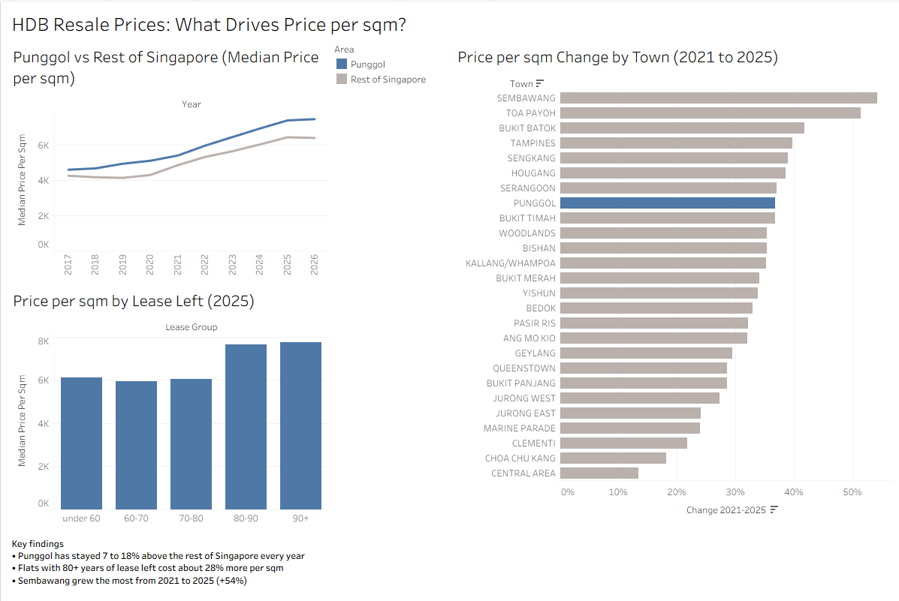

# HDB Resale Price Analysis

Analysis of HDB resale transactions in Singapore from 2017 to 2026, looking at what affects price per sqm.

**[View the dashboard on Tableau Public](https://public.tableau.com/app/profile/angelo.howe.de.leon/viz/HDBResalePricesDashboard/HDBDashboard)**

## Questions

1. Which towns grew the most in price per sqm from 2021 to 2025?
2. How much does the lease left affect price per sqm?
3. How does Punggol compare to the rest of Singapore?

## Key findings

**1. Town growth (2021 to 2025)**

| Rank | Town | Change |
|---|---|---|
| 1 | Sembawang | +54.2% |
| 2 | Toa Payoh | +51.3% |
| 3 | Bukit Batok | +41.7% |
| 8 | Punggol | +36.8% |

Punggol is 8th out of 26 towns. Central Area grew the least.

**2. Lease left (2025)**

| Lease left | Median price per sqm |
|---|---|
| Under 60 years | $6,119 |
| 60 to 70 years | $5,945 |
| 70 to 80 years | $6,045 |
| 80 to 90 years | $7,660 |
| 90+ years | $7,742 |

Flats with 80+ years left cost about 28% more per sqm than flats with 60 to 80 years left. Below 80 years, the price per sqm stays about the same.

**3. Punggol vs rest of Singapore**

- Punggol's median price per sqm has been 7 to 18% higher than the rest of Singapore every year
- From 2017 to 2025, Punggol went up about 61%, compared to about 52% for Singapore overall

## Tools

- **Python (pandas)** for cleaning and analysis
- **Jupyter Notebook** in VS Code
- **Tableau Public** for the dashboard

## Data

HDB resale flat prices from [data.gov.sg](https://data.gov.sg), about 245,000 transactions from January 2017 onwards.

2026 is not a full year yet, so the 2026 numbers may still change.

## Files

| File | What it is |
|---|---|
| `hdb_analysis.ipynb` | Cleaning and analysis notebook |
| `data/resale-prices.csv` | Raw data from data.gov.sg |
| `data/hdb_clean.csv` | Cleaned data used for Tableau |
| `images/dashboard.png` | Dashboard screenshot |

## Author

Angelo Howe De Leon, Diploma in Information Technology (Full Stack Development), Republic Polytechnic